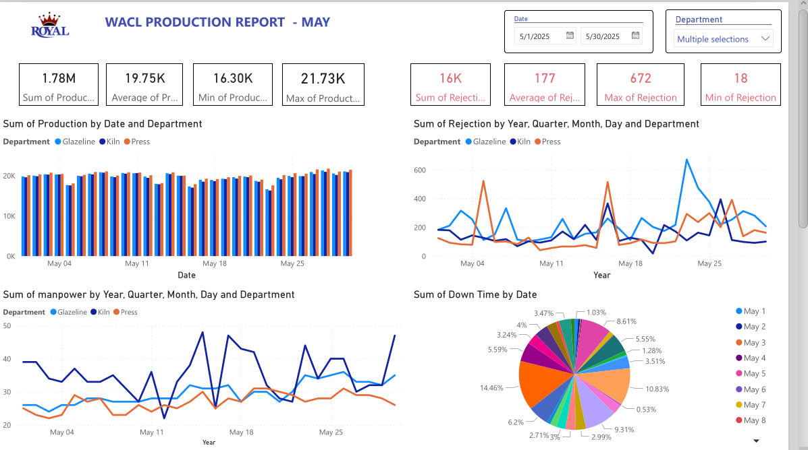
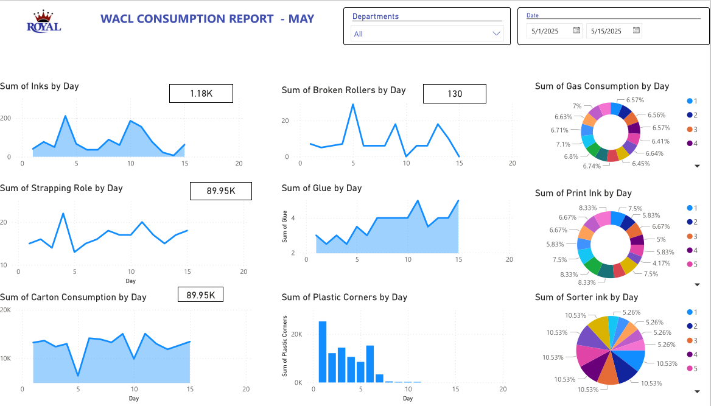

# Production Performance & KPI Dashboard (Power BI)

## Project Overview

A Power BI dashboard built on Orion ERP extracts for **West African Ceramics Limited (WACL)**. It gives production and operations teams a daily view of output, rejection, manpower, and downtime across three production departments: GlazeLine, Kiln, and Press.

The dashboard replaces manual spreadsheet compilation with a validated, refreshable KPI view used in daily production reviews and month-end reporting.

## Tech Stack

- **Power BI:** star-schema data modeling, DAX measures, and report design.
- **Power Query:** cleaning and consolidating ERP extracts, handling duplicates and null values.
- **Excel:** source validation and ad-hoc analysis.
- **Manufacturing domain:** production output, rejection rate, manpower utilization, downtime, and raw-material consumption.

## KPIs Tracked

- **Production output** by date and department.
- **Rejection rate** by date and department.
- **Manpower utilization** by date and department.
- **Downtime** by date and cause.
- **Raw-material consumption** by material and production line.

## Business Impact

- Gave department heads a single daily view of production, rejection, manpower, and downtime instead of separate manual reports.
- Cut month-end reporting turnaround by **20%** by automating data validation and consolidating raw-material consumption reports in Power Query and advanced Excel.
- Saved approximately **10 hours of manual work per month** (~120 hours/year).
- Supported faster intervention when rejection or downtime spiked.

## Repository Contents

- `Production-kpi-dashboard.pbix` — Power BI report file.
- `asset/dashboard_2.png` — consumption report preview.
- `asset/dashboard_3.png` — production report preview.

## Data Privacy

The `.pbix` file and screenshots currently contain production data from West African Ceramics. Before sharing this repository publicly, replace them with aggregated or synthetic data, or confirm written permission from your employer.

## Dashboard Preview

